<!-- ==========================================================================
     VISHNUPRIYAN (gamer003-rgb) — PRO GAMING CYBER-HUD PROFILE README
     Dual-Theme Engine: Auto-adapts to System Dark / Light Theme on GitHub
     Aesthetic: RGB Cyberpunk Gaming HUD & Cleanroom Mecha Esports Architecture
     Zero Duplicate Images: 100% Single-Instance Native Picture Elements
     ========================================================================== -->

<!-- Dual-Theme Animated Cyberpunk RGB Battlestation Header Banner -->

  <picture>
    <source media="(prefers-color-scheme: dark)" srcset="https://raw.githubusercontent.com/vishnupriyangamer003-rgb/vishnupriyangamer003-rgb/main/assets/images/cyber_header_dark.svg">
    <source media="(prefers-color-scheme: light)" srcset="https://raw.githubusercontent.com/vishnupriyangamer003-rgb/vishnupriyangamer003-rgb/main/assets/images/cyber_header_light.svg">
    
  </picture>

<!-- Dual-Theme Live Animated Gaming Terminal Stream -->

  <picture>
    <source media="(prefers-color-scheme: dark)" srcset="https://readme-typing-svg.demolab.com?font=Fira+Code&amp;weight=600&amp;size=17&amp;pause=1000&amp;color=00F0FF&amp;center=true&amp;vCenter=true&amp;width=800&amp;lines=%3E+%5BCALLSIGN%5D+GAMER003-RGB;%3E+%5BROLE%5D+FULL-STACK+DEV;%3E+%5BSTATUS%5D+BUILDING+BOTOS;%3E+%5BMODE%5D+AUTOMATE+%26+OPTIMIZE">
    <source media="(prefers-color-scheme: light)" srcset="https://readme-typing-svg.demolab.com?font=Fira+Code&amp;weight=600&amp;size=17&amp;pause=1000&amp;color=0284C7&amp;center=true&amp;vCenter=true&amp;width=800&amp;lines=%3E+%5BCALLSIGN%5D+GAMER003-RGB;%3E+%5BROLE%5D+FULL-STACK+DEV;%3E+%5BSTATUS%5D+BUILDING+BOTOS;%3E+%5BMODE%5D+AUTOMATE+%26+OPTIMIZE">
    
  </picture>

<!-- Dual-Theme Animated Cyber Laser Divider -->

  <picture>
    <source media="(prefers-color-scheme: dark)" srcset="https://raw.githubusercontent.com/vishnupriyangamer003-rgb/vishnupriyangamer003-rgb/main/assets/images/cyber_divider.svg">
    <source media="(prefers-color-scheme: light)" srcset="https://raw.githubusercontent.com/vishnupriyangamer003-rgb/vishnupriyangamer003-rgb/main/assets/images/cyber_divider_light.svg">
    
  </picture>

## 🕹️ Character Lore & Player Bio

<table width="100%" border="0" cellspacing="0" cellpadding="0">
<tr>
<td width="55%" valign="top">

I'm a full-stack web developer and software architect with a gamer's passion for solving challenging puzzles and crafting clean, reliable digital experiences. From building enterprise inventory systems to designing automation layers for AI tooling, I focus on practical systems that are useful, scalable, and maintainable.

* 🎯 **Current Raid Quest:** [**BotOS**](https://github.com/vishnupriyangamer003-rgb/os-develepement) — an autonomous action & tool orchestration layer for Atom AI
* ⚔️ **Primary Weapon (Main Stack):** PHP 8.x, CodeIgniter, MySQL, JavaScript, HTML5, CSS3, Bootstrap
* ⚡ **Next Skill Tree Unlocks:** React, Node.js, REST & GraphQL APIs, RAG Workflows
* 🧰 **Battlestation Gear:** Git, GitHub, Composer, npm, XAMPP, VS Code
* 🤝 **Co-Op Interests:** Practical tools, backend architecture, automation pipelines, clean design

</td>
<td width="45%" align="center" valign="middle">

<picture>
  <source media="(prefers-color-scheme: dark)" srcset="https://raw.githubusercontent.com/vishnupriyangamer003-rgb/vishnupriyangamer003-rgb/main/assets/images/yali_animated_hud.svg">
  <source media="(prefers-color-scheme: light)" srcset="https://raw.githubusercontent.com/vishnupriyangamer003-rgb/vishnupriyangamer003-rgb/main/assets/images/yali_animated_hud_light.svg">
  
</picture>

 

<picture>
  <source media="(prefers-color-scheme: dark)" srcset="https://readme-typing-svg.demolab.com?font=Fira+Code&amp;weight=600&amp;size=13&amp;pause=900&amp;color=00F0FF&amp;lines=%3E+Initializing+BotOS+Kernel...;%3E+Allocating+action+bus+memory...;%3E+Linking+Atom+AI+reasoning+layer...;%3E+Ready+for+deployment+sequence...">
  <source media="(prefers-color-scheme: light)" srcset="https://readme-typing-svg.demolab.com?font=Fira+Code&amp;weight=600&amp;size=13&amp;pause=900&amp;color=0284C7&amp;lines=%3E+Initializing+BotOS+Kernel...;%3E+Allocating+action+bus+memory...;%3E+Linking+Atom+AI+reasoning+layer...;%3E+Ready+for+deployment+sequence...">
  
</picture>

</td>
</tr>
</table>

<!-- Dual-Theme Animated Cyber Laser Divider -->

  <picture>
    <source media="(prefers-color-scheme: dark)" srcset="https://raw.githubusercontent.com/vishnupriyangamer003-rgb/vishnupriyangamer003-rgb/main/assets/images/cyber_divider.svg">
    <source media="(prefers-color-scheme: light)" srcset="https://raw.githubusercontent.com/vishnupriyangamer003-rgb/vishnupriyangamer003-rgb/main/assets/images/cyber_divider_light.svg">
    
  </picture>

## 📊 GitHub Live Telemetry

  <picture>
    <source media="(prefers-color-scheme: dark)" srcset="https://github-readme-stats.vercel.app/api?username=vishnupriyangamer003-rgb&amp;show_icons=true&amp;bg_color=00000000&amp;title_color=00F0FF&amp;text_color=E2E8F0&amp;icon_color=FF007F&amp;border_color=00F0FF">
    <source media="(prefers-color-scheme: light)" srcset="https://github-readme-stats.vercel.app/api?username=vishnupriyangamer003-rgb&amp;show_icons=true&amp;bg_color=00000000&amp;title_color=0284C7&amp;text_color=0F172A&amp;icon_color=FF007F&amp;border_color=0284C7">
    
  </picture>
  &nbsp;&nbsp;
  <picture>
    <source media="(prefers-color-scheme: dark)" srcset="https://github-readme-stats.vercel.app/api/top-langs/?username=vishnupriyangamer003-rgb&amp;repo=vishnupriyangamer003-rgb&amp;layout=compact&amp;langs_count=5&amp;bg_color=00000000&amp;title_color=00F0FF&amp;text_color=E2E8F0&amp;icon_color=FF007F&amp;border_color=00F0FF">
    <source media="(prefers-color-scheme: light)" srcset="https://github-readme-stats.vercel.app/api/top-langs/?username=vishnupriyangamer003-rgb&amp;repo=vishnupriyangamer003-rgb&amp;layout=compact&amp;langs_count=5&amp;bg_color=00000000&amp;title_color=0284C7&amp;text_color=0F172A&amp;icon_color=FF007F&amp;border_color=0284C7">
    
  </picture>

<!-- Dual-Theme Animated Cyber Laser Divider -->

  <picture>
    <source media="(prefers-color-scheme: dark)" srcset="https://raw.githubusercontent.com/vishnupriyangamer003-rgb/vishnupriyangamer003-rgb/main/assets/images/cyber_divider.svg">
    <source media="(prefers-color-scheme: light)" srcset="https://raw.githubusercontent.com/vishnupriyangamer003-rgb/vishnupriyangamer003-rgb/main/assets/images/cyber_divider_light.svg">
    
  </picture>

## 📁 Quest Archives & Popular Repositories

<table width="100%" border="0" cellspacing="0" cellpadding="0">
<tr>
<td width="50%" valign="top">
  <b><a href="https://github.com/vishnupriyangamer003-rgb/os-develepement">os-develepement</a></b> &nbsp; <code>Public Quest</code> 
  Flagship Project &middot; Action and tool orchestration layer for Atom AI 
  🟣 <code>PHP</code> &middot; <code>AI Tooling</code>
</td>
<td width="50%" valign="top">
  <b><a href="https://github.com/vishnupriyangamer003-rgb/realtex">realtex</a></b> &nbsp; <code>Public Quest</code> 
  Enterprise management system &middot; Relational database integration 
  🟣 <code>PHP</code> &middot; <code>MySQL</code>
</td>
</tr>
<tr>
<td colspan="2" valign="top">
   
  <b><a href="https://github.com/vishnupriyangamer003-rgb/vishnupriyangamer003-rgb">vishnupriyangamer003-rgb</a></b> &nbsp; <code>Public Quest</code> 
  Profile Hub &middot; Dual-theme adaptive RGB gaming portfolio presentation 
  🔵 <code>CSS</code> &middot; <code>SVG HUD</code>
</td>
</tr>
</table>

<!-- Dual-Theme Animated Cyber Laser Divider -->

  <picture>
    <source media="(prefers-color-scheme: dark)" srcset="https://raw.githubusercontent.com/vishnupriyangamer003-rgb/vishnupriyangamer003-rgb/main/assets/images/cyber_divider.svg">
    <source media="(prefers-color-scheme: light)" srcset="https://raw.githubusercontent.com/vishnupriyangamer003-rgb/vishnupriyangamer003-rgb/main/assets/images/cyber_divider_light.svg">
    
  </picture>

<!-- Streak & Party Lobby Section -->
<table width="100%" border="0" cellspacing="0" cellpadding="0">
<tr>
<td width="50%" valign="top">

### 🔥 Daily Commit Streak

  <picture>
    <source media="(prefers-color-scheme: dark)" srcset="https://streak-stats.demolab.com?user=vishnupriyangamer003-rgb&amp;theme=dark&amp;background=00000000&amp;border=00F0FF&amp;stroke=00F0FF&amp;ring=00F0FF&amp;fire=FF007F&amp;currStreakLabel=00F0FF">
    <source media="(prefers-color-scheme: light)" srcset="https://streak-stats.demolab.com?user=vishnupriyangamer003-rgb&amp;theme=light&amp;background=00000000&amp;border=0284C7&amp;stroke=0284C7&amp;ring=0284C7&amp;fire=FF007F&amp;currStreakLabel=0284C7">
    
  </picture>

</td>
<td width="50%" valign="top">

### 📡 Join The Party / Co-Op Lobby

Looking for a dedicated backend architect or eager to collaborate on AI action tools? Send a party invite:

  <a href="https://github.com/vishnupriyangamer003-rgb">
    <picture>
      <source media="(prefers-color-scheme: dark)" srcset="https://img.shields.io/badge/GitHub-gamer003--rgb-00F0FF?style=for-the-badge&amp;logo=github&amp;logoColor=0D1117">
      <source media="(prefers-color-scheme: light)" srcset="https://img.shields.io/badge/GitHub-gamer003--rgb-0284C7?style=for-the-badge&amp;logo=github&amp;logoColor=ffffff">
      
    </picture>
  </a>
  <a href="https://github.com/vishnupriyangamer003-rgb">
    <picture>
      <source media="(prefers-color-scheme: dark)" srcset="https://img.shields.io/badge/Portfolio-LIVE%20HUD-FF007F?style=for-the-badge&amp;logo=googlechrome&amp;logoColor=white">
      <source media="(prefers-color-scheme: light)" srcset="https://img.shields.io/badge/Portfolio-LIVE%20HUD-6366F1?style=for-the-badge&amp;logo=googlechrome&amp;logoColor=white">
      
    </picture>
  </a>
  

*“Build useful things. Level up continuously. Win as a team.”*

</td>
</tr>
</table>

<!-- Dual-Theme Animated Cyber Laser Footer Wave -->

  <b>VISHNUPRIYAN // GAMER003-RGB &lt;/&gt; LEVEL 99 FULL-STACK DEVELOPER</b> 
  <code>CODE &middot; CREATE &middot; AUTOMATE &middot; EXPLORE &middot; CONQUER</code>

  <picture>
    <source media="(prefers-color-scheme: dark)" srcset="https://raw.githubusercontent.com/vishnupriyangamer003-rgb/vishnupriyangamer003-rgb/main/assets/images/cyber_footer_dark.svg">
    <source media="(prefers-color-scheme: light)" srcset="https://raw.githubusercontent.com/vishnupriyangamer003-rgb/vishnupriyangamer003-rgb/main/assets/images/cyber_footer_light.svg">
    
  </picture>

