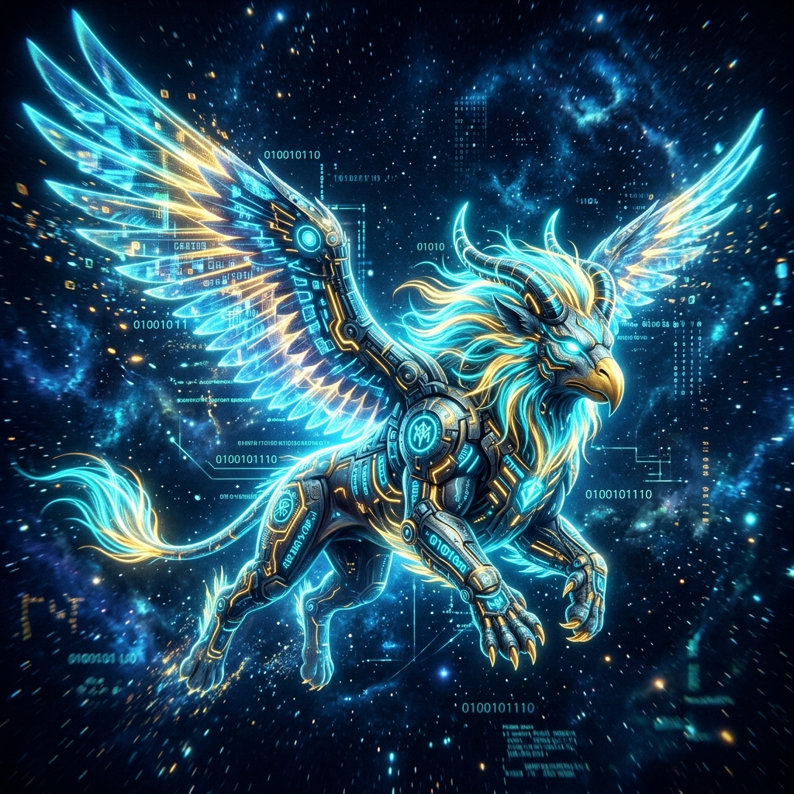

<!-- ==========================================================================
     VISHNUPRIYAN (gamer003-rgb) — PRO GAMING CYBER-HUD PROFILE README
     Dual-Theme Engine: Auto-adapts to System Dark / Light Theme on GitHub
     Aesthetic: RGB Cyberpunk Gaming HUD & Cleanroom Mecha Esports Architecture
     Zero Black-Box Glitches: 100% Transparent Adaptive SVGs & Vectors
     ========================================================================== -->

<!-- Dual-Theme Animated Gaming RGB Waving Header Banner -->
<p align="center">
  <picture>
    <source media="(prefers-color-scheme: dark)" srcset="https://capsule-render.vercel.app/api?type=waving&height=230&color=0:0D1117,25:1E1B4B,55:7928CA,85:00F0FF,100:FF007F&text=VISHNUPRIYAN&fontColor=FFFFFF&fontSize=52&fontAlignY=36&desc=LEVEL%2099%20PHP%20DEVELOPER%20%7C%20AI%20SOLUTIONS%20%7C%20GAMER003-RGB&descColor=00F0FF&descSize=16&descAlignY=60&animation=fadeIn">
    <source media="(prefers-color-scheme: light)" srcset="https://capsule-render.vercel.app/api?type=waving&height=230&color=0:FFFFFF,30:F1F5F9,70:BAE6FD,100:0284C7&text=VISHNUPRIYAN&fontColor=0F172A&fontSize=52&fontAlignY=36&desc=LEVEL%2099%20PHP%20DEVELOPER%20%7C%20AI%20SOLUTIONS%20%7C%20GAMER003-RGB&descColor=0284C7&descSize=16&descAlignY=60&animation=fadeIn">
    
  </picture>
</p>

<!-- Dual-Theme Live Animated Gaming Terminal Stream -->
<p align="center">
  <picture>
    <source media="(prefers-color-scheme: dark)" srcset="https://readme-typing-svg.demolab.com?font=Fira+Code&weight=600&size=17&pause=1000&color=00F0FF&center=true&vCenter=true&width=800&lines=%3E+%5BCALLSIGN%5D%3A+vishnupriyangamer003-rgb+%7C+LVL+99+FULL-STACK+DEV;%3E+%5BLOADOUT%5D%3A+PHP+8.x+%E2%80%A2+CodeIgniter+%E2%80%A2+MySQL+%E2%80%A2+JavaScript+%E2%80%A2+Bootstrap;%3E+%5BMAIN+QUEST%5D%3A+BotOS+%E2%80%94+Action+Layer+%26+Tool+Bus+for+Atom+AI;%3E+%5BPASSIVE+BUFF%5D%3A+Ancient+Strength+%C3%97+Modern+Tech+%7C+Yali+Philosophy;%3E+%5BLOBBY+STATUS%5D%3A+READY+FOR+CO-OP+%7C+ACCEPTING+NEW+PROJECTS">
    <source media="(prefers-color-scheme: light)" srcset="https://readme-typing-svg.demolab.com?font=Fira+Code&weight=600&size=17&pause=1000&color=0284C7&center=true&vCenter=true&width=800&lines=%3E+%5BCALLSIGN%5D%3A+vishnupriyangamer003-rgb+%7C+LVL+99+FULL-STACK+DEV;%3E+%5BLOADOUT%5D%3A+PHP+8.x+%E2%80%A2+CodeIgniter+%E2%80%A2+MySQL+%E2%80%A2+JavaScript+%E2%80%A2+Bootstrap;%3E+%5BMAIN+QUEST%5D%3A+BotOS+%E2%80%94+Action+Layer+%26+Tool+Bus+for+Atom+AI;%3E+%5BPASSIVE+BUFF%5D%3A+Ancient+Strength+%C3%97+Modern+Tech+%7C+Yali+Philosophy;%3E+%5BLOBBY+STATUS%5D%3A+READY+FOR+CO-OP+%7C+ACCEPTING+NEW+PROJECTS">
    
  </picture>
</p>

<!-- Dual-Theme Animated Cyber Laser Divider -->
<p align="center">
  <picture>
    <source media="(prefers-color-scheme: dark)" srcset="assets/images/cyber_divider.svg">
    <source media="(prefers-color-scheme: light)" srcset="assets/images/cyber_divider_light.svg">
    
  </picture>
</p>

<!-- Top Hero & Player Profile Battlestation Matrix -->
<table width="100%" border="0" cellspacing="0" cellpadding="0">
<tr>
<td width="55%" valign="top">

```bash
vishnupriyan@battlestation:~$ ./initialize_profile --gamer-mode=rgb
```

# 🎮 Vishnupriyan `[gamer003-rgb]`

<p>
  <picture>
    <source media="(prefers-color-scheme: dark)" srcset="https://img.shields.io/badge/RANK-LVL%2099%20DEV-00F0FF?style=for-the-badge&logo=riotgames&logoColor=00F0FF">
    <source media="(prefers-color-scheme: light)" srcset="https://img.shields.io/badge/RANK-LVL%2099%20DEV-0284C7?style=for-the-badge&logo=riotgames&logoColor=0284C7">
    
  </picture>
  <picture>
    <source media="(prefers-color-scheme: dark)" srcset="https://img.shields.io/badge/CLASS-BACKEND%20TANK-7928CA?style=for-the-badge&logo=shield&logoColor=white">
    <source media="(prefers-color-scheme: light)" srcset="https://img.shields.io/badge/CLASS-BACKEND%20TANK-6366F1?style=for-the-badge&logo=shield&logoColor=white">
    
  </picture>
  <picture>
    <source media="(prefers-color-scheme: dark)" srcset="https://img.shields.io/badge/STATUS-ONLINE%20CO--OP-10B981?style=for-the-badge&logo=target&logoColor=white">
    <source media="(prefers-color-scheme: light)" srcset="https://img.shields.io/badge/STATUS-ONLINE%20CO--OP-059669?style=for-the-badge&logo=target&logoColor=white">
    
  </picture>
</p>

* **⚔️ Core Mission:** Building robust Web Applications &amp; Management Systems
* **🤖 Quest in Progress:** BotOS — Action &amp; Tool Orchestration Layer for Atom AI
* **⚡ Playstyle:** Clean Code &middot; Modular Architecture &middot; Zero Friction

<p>
  
  
  
  
  
</p>

*“Ancient Strength × Modern Technology · One Commit At A Time”*

</td>
<td width="45%" align="center" valign="middle">

<picture>
  <source media="(prefers-color-scheme: dark)" srcset="assets/images/gamer_hud_card_dark.svg">
  <source media="(prefers-color-scheme: light)" srcset="assets/images/gamer_hud_card_light.svg">
  
</picture>

<br><br>

<picture>
  <source media="(prefers-color-scheme: dark)" srcset="assets/images/yali_guardian.jpg">
  <source media="(prefers-color-scheme: light)" srcset="assets/images/yali_hologram_light.jpg">
  
</picture>

</td>
</tr>
</table>

<!-- Quick HUD Navigation Pills -->
<p align="center">
  <picture>
    <source media="(prefers-color-scheme: dark)" srcset="https://img.shields.io/badge/🕹️-Character_Lore-00F0FF?style=flat-square">
    <source media="(prefers-color-scheme: light)" srcset="https://img.shields.io/badge/🕹️-Character_Lore-0284C7?style=flat-square">
    
  </picture>
  <picture>
    <source media="(prefers-color-scheme: dark)" srcset="https://img.shields.io/badge/⚔️-Skill_Tree-00F0FF?style=flat-square">
    <source media="(prefers-color-scheme: light)" srcset="https://img.shields.io/badge/⚔️-Skill_Tree-0284C7?style=flat-square">
    
  </picture>
  <picture>
    <source media="(prefers-color-scheme: dark)" srcset="https://img.shields.io/badge/📜-Active_Quests-00F0FF?style=flat-square">
    <source media="(prefers-color-scheme: light)" srcset="https://img.shields.io/badge/📜-Active_Quests-0284C7?style=flat-square">
    
  </picture>
  <picture>
    <source media="(prefers-color-scheme: dark)" srcset="https://img.shields.io/badge/📊-Telemetry_Stats-00F0FF?style=flat-square">
    <source media="(prefers-color-scheme: light)" srcset="https://img.shields.io/badge/📊-Telemetry_Stats-0284C7?style=flat-square">
    
  </picture>
  <picture>
    <source media="(prefers-color-scheme: dark)" srcset="https://img.shields.io/badge/🏆-Achievements-00F0FF?style=flat-square">
    <source media="(prefers-color-scheme: light)" srcset="https://img.shields.io/badge/🏆-Achievements-0284C7?style=flat-square">
    
  </picture>
  <picture>
    <source media="(prefers-color-scheme: dark)" srcset="https://img.shields.io/badge/📡-Party_Lobby-00F0FF?style=flat-square">
    <source media="(prefers-color-scheme: light)" srcset="https://img.shields.io/badge/📡-Party_Lobby-0284C7?style=flat-square">
    
  </picture>
</p>

<!-- Dual-Theme Animated Cyber Laser Divider -->
<p align="center">
  <picture>
    <source media="(prefers-color-scheme: dark)" srcset="assets/images/cyber_divider.svg">
    <source media="(prefers-color-scheme: light)" srcset="assets/images/cyber_divider_light.svg">
    
  </picture>
</p>

## 🕹️ Character Lore & Player Bio

<table width="100%" border="0" cellspacing="0" cellpadding="0">
<tr>
<td width="55%" valign="top">

I'm a full-stack web developer and software architect with a gamer's passion for solving challenging puzzles and crafting clean, reliable digital experiences. From building enterprise inventory systems to engineering AI agent tool layers, I treat every project like a raid boss: meticulously planned, cleanly executed, and fully optimized.

* 🎯 **Current Raid Quest:** [**BotOS**](https://github.com/vishnupriyangamer003-rgb/os-develepement) — an autonomous action &amp; tool orchestration layer for Atom AI
* ⚔️ **Primary Weapon (Main Stack):** PHP 8.x, CodeIgniter, MySQL, JavaScript, HTML5, CSS3, Bootstrap
* ⚡ **Next Skill Tree Unlocks:** React, Node.js, REST &amp; GraphQL APIs, RAG Workflows
* 🧰 **Battlestation Gear:** Git, GitHub, Composer, npm, XAMPP, VS Code
* 🤝 **Co-Op Interests:** Practical tools, backend architecture, automation pipelines, clean design

</td>
<td width="45%" align="center" valign="middle">

<picture>
  <source media="(prefers-color-scheme: dark)" srcset="assets/images/yali_animated_hud.svg">
  <source media="(prefers-color-scheme: light)" srcset="assets/images/yali_animated_hud_light.svg">
  
</picture>

<br>

<picture>
  <source media="(prefers-color-scheme: dark)" srcset="https://readme-typing-svg.demolab.com?font=Fira+Code&weight=600&size=13&pause=900&color=00F0FF&lines=%3E+Initializing+BotOS+Kernel...;%3E+Allocating+action+bus+memory...;%3E+Connecting+Atom+AI+neural+link...;%3E+Executing+RAG+retrieval+pipeline...;%3E+All+systems+nominal.+100%25+Online.">
  <source media="(prefers-color-scheme: light)" srcset="https://readme-typing-svg.demolab.com?font=Fira+Code&weight=600&size=13&pause=900&color=0284C7&lines=%3E+Initializing+BotOS+Kernel...;%3E+Allocating+action+bus+memory...;%3E+Connecting+Atom+AI+neural+link...;%3E+Executing+RAG+retrieval+pipeline...;%3E+All+systems+nominal.+100%25+Online.">
  
</picture>

</td>
</tr>
</table>

<!-- Dual-Theme Animated Cyber Laser Divider -->
<p align="center">
  <picture>
    <source media="(prefers-color-scheme: dark)" srcset="assets/images/cyber_divider.svg">
    <source media="(prefers-color-scheme: light)" srcset="assets/images/cyber_divider_light.svg">
    
  </picture>
</p>

## ⚔️ Skill Tree & Weapon Inventory

<!-- Dual-Theme Vector Tech Icons (Auto adapts with zero black-box confusion) -->
<p align="center">
  <picture>
    <source media="(prefers-color-scheme: dark)" srcset="https://skillicons.dev/icons?i=php,mysql,html,css,js,bootstrap,git,github,vscode&theme=dark">
    <source media="(prefers-color-scheme: light)" srcset="https://skillicons.dev/icons?i=php,mysql,html,css,js,bootstrap,git,github,vscode&theme=light">
    
  </picture>
</p>

#### 🗡️ Primary Weapons (Backend & Architecture)
<p>
  
  
  
  
  
</p>

#### 🛡️ Secondary Gear (Frontend & UI Agility)
<p>
  
  
  
  
  
  
</p>

#### 🔮 Skill Tree Unlocks (In Progress)
<p>
  
  
  
  
  
</p>

<!-- Dual-Theme Animated Cyber Laser Divider -->
<p align="center">
  <picture>
    <source media="(prefers-color-scheme: dark)" srcset="assets/images/cyber_divider.svg">
    <source media="(prefers-color-scheme: light)" srcset="assets/images/cyber_divider_light.svg">
    
  </picture>
</p>

<!-- Featured Project Quest & GitHub Stats HUD -->
<table width="100%" border="0" cellspacing="0" cellpadding="0">
<tr>
<td width="48%" valign="top">

### 🚀 Legendary Quest: BotOS

<h4>
  <a href="https://github.com/vishnupriyangamer003-rgb/os-develepement"><b>BotOS / OS Development</b></a>
  &nbsp;
  <picture>
    <source media="(prefers-color-scheme: dark)" srcset="https://img.shields.io/badge/DIFFICULTY-EXPERT-FF007F?style=flat-square">
    <source media="(prefers-color-scheme: light)" srcset="https://img.shields.io/badge/DIFFICULTY-EXPERT-DC2626?style=flat-square">
    
  </picture>
  <picture>
    <source media="(prefers-color-scheme: dark)" srcset="https://img.shields.io/badge/STATUS-ACTIVE%20SPRINT-10B981?style=flat-square">
    <source media="(prefers-color-scheme: light)" srcset="https://img.shields.io/badge/STATUS-ACTIVE%20SPRINT-059669?style=flat-square">
    
  </picture>
</h4>

An autonomous action engine and tool-control layer for **Atom AI**. Designed to bridge high-level model reasoning with structured, deterministic real-world actions while enforcing strict memory and execution isolation.

[**⚔️ Enter Quest Repository &rarr;**](https://github.com/vishnupriyangamer003-rgb/os-develepement)

`AI Agents` &middot; `Automation Bus` &middot; `Action Layers` &middot; `PHP Core`

<details>
  <summary><b>⚡ BotOS Telemetry Diagnostics</b></summary>
  <p>
    <code>&gt; CORE_STATUS: ONLINE (CYCLE: 4.20 GHz)</code><br>
    <code>&gt; MEMORY_MAP: ALLOCATED &amp; VERIFIED</code><br>
    <code>&gt; ACTION_BUS: LISTENING ON DISPATCH</code><br>
    <code>&gt; ATOM_AI_LINK: SYNCHRONIZED</code>
  </p>
</details>

</td>
<td width="52%" valign="top">

### 📊 GitHub Live Telemetry

<p align="center">
  <picture>
    <source media="(prefers-color-scheme: dark)" srcset="https://github-readme-stats.vercel.app/api?username=vishnupriyangamer003-rgb&show_icons=true&bg_color=00000000&title_color=00F0FF&text_color=E2E8F0&icon_color=FF007F&border_color=00F0FF&border_radius=12&rank_icon=github">
    <source media="(prefers-color-scheme: light)" srcset="https://github-readme-stats.vercel.app/api?username=vishnupriyangamer003-rgb&show_icons=true&bg_color=00000000&title_color=0284C7&text_color=0F172A&icon_color=0284C7&border_color=0284C7&border_radius=12&rank_icon=github">
    
  </picture>
</p>

<p align="center">
  <picture>
    <source media="(prefers-color-scheme: dark)" srcset="https://github-readme-stats.vercel.app/api/top-langs/?username=vishnupriyangamer003-rgb&layout=compact&langs_count=5&bg_color=00000000&title_color=00F0FF&text_color=E2E8F0&border_color=00F0FF&border_radius=12">
    <source media="(prefers-color-scheme: light)" srcset="https://github-readme-stats.vercel.app/api/top-langs/?username=vishnupriyangamer003-rgb&layout=compact&langs_count=5&bg_color=00000000&title_color=0284C7&text_color=0F172A&border_color=0284C7&border_radius=12">
    
  </picture>
</p>

</td>
</tr>
</table>

<!-- Dual-Theme Animated Cyber Laser Divider -->
<p align="center">
  <picture>
    <source media="(prefers-color-scheme: dark)" srcset="assets/images/cyber_divider.svg">
    <source media="(prefers-color-scheme: light)" srcset="assets/images/cyber_divider_light.svg">
    
  </picture>
</p>

## 📁 Quest Archives & Popular Repositories

<table width="100%" border="0" cellspacing="0" cellpadding="0">
<tr>
<td width="50%" valign="top">
  <b><a href="https://github.com/vishnupriyangamer003-rgb/os-develepement">os-develepement</a></b> &nbsp; <code>Public Quest</code><br>
  <sub>Flagship Project &middot; Action and tool orchestration layer for Atom AI</sub><br>
  🟣 <code>PHP</code> &middot; <code>AI Tooling</code>
</td>
<td width="50%" valign="top">
  <b><a href="https://github.com/vishnupriyangamer003-rgb/vishnupriyangamer003-rgb">vishnupriyangamer003-rgb</a></b> &nbsp; <code>Public Quest</code><br>
  <sub>Profile Hub &middot; Dual-theme adaptive RGB gaming portfolio presentation</sub><br>
  🔵 <code>CSS</code> &middot; <code>SVG HUD</code>
</td>
</tr>
<tr>
<td width="50%" valign="top">
  <b><a href="https://github.com/vishnupriyangamer003-rgb/kasi">kasi</a></b> &nbsp; <code>Public Quest</code><br>
  <sub>Web application &middot; Highly responsive user interface implementation</sub><br>
  🔵 <code>CSS</code> &middot; <code>JavaScript</code>
</td>
<td width="50%" valign="top">
  <b><a href="https://github.com/vishnupriyangamer003-rgb/realtex">realtex</a></b> &nbsp; <code>Public Quest</code><br>
  <sub>Enterprise management system &middot; Relational database integration</sub><br>
  🟣 <code>PHP</code> &middot; <code>MySQL</code>
</td>
</tr>
</table>

<!-- Dual-Theme Animated Cyber Laser Divider -->
<p align="center">
  <picture>
    <source media="(prefers-color-scheme: dark)" srcset="assets/images/cyber_divider.svg">
    <source media="(prefers-color-scheme: light)" srcset="assets/images/cyber_divider_light.svg">
    
  </picture>
</p>

<!-- Streak & Party Lobby Section -->
<table width="100%" border="0" cellspacing="0" cellpadding="0">
<tr>
<td width="50%" valign="top">

### 🔥 Daily Commit Streak

<p align="center">
  <picture>
    <source media="(prefers-color-scheme: dark)" srcset="https://streak-stats.demolab.com?user=vishnupriyangamer003-rgb&theme=dark&background=00000000&border=00F0FF&stroke=00F0FF&ring=00F0FF&fire=FF007F&currStreakNum=00F0FF&sideNums=E2E8F0&currStreakLabel=00F0FF&sideLabels=94A3B8&dates=64748B&border_radius=12">
    <source media="(prefers-color-scheme: light)" srcset="https://streak-stats.demolab.com?user=vishnupriyangamer003-rgb&theme=light&background=00000000&border=0284C7&stroke=0284C7&ring=0284C7&fire=0284C7&currStreakNum=0284C7&sideNums=0F172A&currStreakLabel=0284C7&sideLabels=475569&dates=64748B&border_radius=12">
    
  </picture>
</p>

</td>
<td width="50%" valign="top">

### 📡 Join The Party / Co-Op Lobby

Looking for a dedicated backend architect or eager to collaborate on AI action tools? Send a party invite:

<p>
  <a href="https://github.com/vishnupriyangamer003-rgb">
    <picture>
      <source media="(prefers-color-scheme: dark)" srcset="https://img.shields.io/badge/GitHub-gamer003--rgb-00F0FF?style=for-the-badge&logo=github&logoColor=0D1117">
      <source media="(prefers-color-scheme: light)" srcset="https://img.shields.io/badge/GitHub-gamer003--rgb-0284C7?style=for-the-badge&logo=github&logoColor=ffffff">
      
    </picture>
  </a>
  <a href="https://github.com/vishnupriyangamer003-rgb">
    <picture>
      <source media="(prefers-color-scheme: dark)" srcset="https://img.shields.io/badge/Portfolio-LIVE%20HUD-FF007F?style=for-the-badge&logo=googlechrome&logoColor=white">
      <source media="(prefers-color-scheme: light)" srcset="https://img.shields.io/badge/Portfolio-LIVE%20HUD-6366F1?style=for-the-badge&logo=googlechrome&logoColor=white">
      
    </picture>
  </a>
  <a href="mailto:vishnupriyangamer003@gmail.com">
    
  </a>
</p>

*“Build useful things. Level up continuously. Win as a team.”*

</td>
</tr>
</table>

<!-- Dual-Theme Animated Footer Wave -->
<p align="center">
  <b>VISHNUPRIYAN // GAMER003-RGB &lt;/&gt; LEVEL 99 FULL-STACK DEVELOPER</b><br>
  <code>CODE &middot; CREATE &middot; AUTOMATE &middot; EXPLORE &middot; CONQUER</code>
</p>

<p align="center">
  <picture>
    <source media="(prefers-color-scheme: dark)" srcset="https://capsule-render.vercel.app/api?type=waving&height=110&section=footer&color=0:FF007F,35:7928CA,70:00F0FF,100:0D1117">
    <source media="(prefers-color-scheme: light)" srcset="https://capsule-render.vercel.app/api?type=waving&height=110&section=footer&color=0:0284C7,45:BAE6FD,80:F1F5F9,100:FFFFFF">
    
  </picture>
</p>
