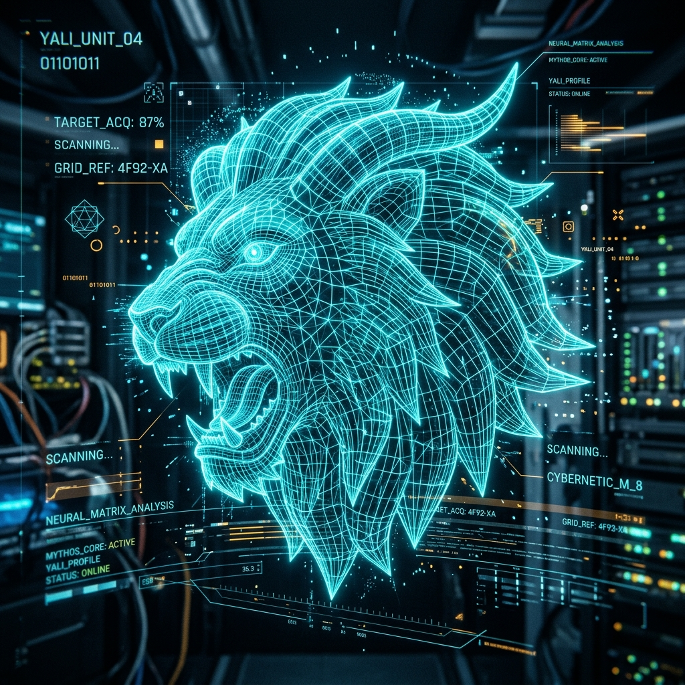

<!-- ==========================================================================
     VISHNUPRIYAN — CYBER-HUD GITHUB PROFILE README
     Dual-Theme Engine: Auto-adapts to System Dark / Light Theme on GitHub
     Aesthetic: Cyberpunk Sci-Fi HUD & Cleanroom Cyber Light Architecture
     ========================================================================== -->

<!-- Dual-Theme Animated Header Waving Banner -->

  <picture>
    <source media="(prefers-color-scheme: dark)" srcset="https://capsule-render.vercel.app/api?type=waving&height=220&color=0:030712,45:0F172A,100:00F0FF&text=Vishnupriyan&fontColor=FFFFFF&fontSize=50&fontAlignY=36&desc=PHP%20Developer%20%7C%20Web%20Applications%20%7C%20AI%20Solutions&descColor=00F0FF&descSize=18&descAlignY=60&animation=fadeIn">
    <source media="(prefers-color-scheme: light)" srcset="https://capsule-render.vercel.app/api?type=waving&height=220&color=0:F8FAFC,45:E2E8F0,100:0284C7&text=Vishnupriyan&fontColor=0F172A&fontSize=50&fontAlignY=36&desc=PHP%20Developer%20%7C%20Web%20Applications%20%7C%20AI%20Solutions&descColor=0284C7&descSize=18&descAlignY=60&animation=fadeIn">
    
  </picture>

<!-- Dual-Theme Live Animated Typing Terminal Introduction -->

  <picture>
    <source media="(prefers-color-scheme: dark)" srcset="https://readme-typing-svg.demolab.com?font=Fira+Code&weight=600&size=18&pause=1000&color=00F0FF&center=true&vCenter=true&width=750&lines=%3E+PHP+Full-Stack+Developer+%7C+CodeIgniter+%7C+MySQL;%3E+Architecting+BotOS+%E2%80%94+Action+Layer+for+Atom+AI;%3E+Ancient+Strength+%C3%97+Modern+Technology+%7C+Yali+Philosophy;%3E+Turning+complex+workflows+into+reliable+software">
    <source media="(prefers-color-scheme: light)" srcset="https://readme-typing-svg.demolab.com?font=Fira+Code&weight=600&size=18&pause=1000&color=0284C7&center=true&vCenter=true&width=750&lines=%3E+PHP+Full-Stack+Developer+%7C+CodeIgniter+%7C+MySQL;%3E+Architecting+BotOS+%E2%80%94+Action+Layer+for+Atom+AI;%3E+Ancient+Strength+%C3%97+Modern+Technology+%7C+Yali+Philosophy;%3E+Turning+complex+workflows+into+reliable+software">
    
  </picture>

<!-- Dual-Theme Animated Cyber Laser Divider -->

  <picture>
    <source media="(prefers-color-scheme: dark)" srcset="assets/images/cyber_divider.svg">
    <source media="(prefers-color-scheme: light)" srcset="assets/images/cyber_divider_light.svg">
    
  </picture>

<!-- Top Hero & Yali Guardian HUD Matrix -->
<table width="100%" border="0" cellspacing="0" cellpadding="0">
  <tr>
    <td width="56%" valign="top">
      
<code>vishnupriyan@github:~$ whoami</code>

      <h1>Vishnupriyan</h1>
      

        <a href="https://github.com/vishnupriyangamer003-rgb">
          <picture>
            <source media="(prefers-color-scheme: dark)" srcset="https://img.shields.io/badge/PHP%20Developer-00F0FF?style=for-the-badge&logo=php&logoColor=030712">
            <source media="(prefers-color-scheme: light)" srcset="https://img.shields.io/badge/PHP%20Developer-0284C7?style=for-the-badge&logo=php&logoColor=ffffff">
            
          </picture>
        </a>
        <picture>
          <source media="(prefers-color-scheme: dark)" srcset="https://img.shields.io/badge/STATUS-ACTIVE%20BUILDER-10B981?style=for-the-badge">
          <source media="(prefers-color-scheme: light)" srcset="https://img.shields.io/badge/STATUS-ACTIVE%20BUILDER-059669?style=for-the-badge">
          
        </picture>
      

      

        <b>&gt; Building Web Applications</b> 
        <b>&gt; Automation Tools &amp; Management Systems</b> 
        <b>&gt; AI Solutions &amp; Action Layers</b>
      

      

        
        
        
        
        
      

      
<em>&ldquo;Code &middot; Create &middot; Automate &middot; Explore &middot; Improve&rdquo;</em>

    </td>
    <td width="44%" align="center" valign="middle">
      

        <!-- Dual-Theme Animated Radar & Telemetry HUD -->
        <picture>
          <source media="(prefers-color-scheme: dark)" srcset="assets/images/yali_animated_hud.svg">
          <source media="(prefers-color-scheme: light)" srcset="assets/images/yali_animated_hud_light.svg">
          
        </picture>
          
        
      

    </td>
  </tr>
</table>

<!-- Quick HUD Navigation Pills -->

  <picture>
    <source media="(prefers-color-scheme: dark)" srcset="https://img.shields.io/badge/👤-About-00F0FF?style=flat-square&logoColor=white">
    <source media="(prefers-color-scheme: light)" srcset="https://img.shields.io/badge/👤-About-0284C7?style=flat-square&logoColor=white">
    
  </picture>
  <picture>
    <source media="(prefers-color-scheme: dark)" srcset="https://img.shields.io/badge/⚙️-Skills-00F0FF?style=flat-square">
    <source media="(prefers-color-scheme: light)" srcset="https://img.shields.io/badge/⚙️-Skills-0284C7?style=flat-square">
    
  </picture>
  <picture>
    <source media="(prefers-color-scheme: dark)" srcset="https://img.shields.io/badge/📁-Projects-00F0FF?style=flat-square">
    <source media="(prefers-color-scheme: light)" srcset="https://img.shields.io/badge/📁-Projects-0284C7?style=flat-square">
    
  </picture>
  <picture>
    <source media="(prefers-color-scheme: dark)" srcset="https://img.shields.io/badge/📊-Stats-00F0FF?style=flat-square">
    <source media="(prefers-color-scheme: light)" srcset="https://img.shields.io/badge/📊-Stats-0284C7?style=flat-square">
    
  </picture>
  <picture>
    <source media="(prefers-color-scheme: dark)" srcset="https://img.shields.io/badge/🌱-Journey-00F0FF?style=flat-square">
    <source media="(prefers-color-scheme: light)" srcset="https://img.shields.io/badge/🌱-Journey-0284C7?style=flat-square">
    
  </picture>
  <picture>
    <source media="(prefers-color-scheme: dark)" srcset="https://img.shields.io/badge/✉️-Connect-00F0FF?style=flat-square">
    <source media="(prefers-color-scheme: light)" srcset="https://img.shields.io/badge/✉️-Connect-0284C7?style=flat-square">
    
  </picture>

<!-- Dual-Theme Animated Cyber Laser Divider -->

  <picture>
    <source media="(prefers-color-scheme: dark)" srcset="assets/images/cyber_divider.svg">
    <source media="(prefers-color-scheme: light)" srcset="assets/images/cyber_divider_light.svg">
    
  </picture>

## 👨‍💻 About Me

<table width="100%" border="0" cellspacing="0" cellpadding="0">
  <tr>
    <td width="56%" valign="top">
      

        I'm a web developer who enjoys building practical applications, management systems, and tools that solve real problems. I'm also exploring how AI assistants can work with software tools in a structured and reliable way.
      

      <ul>
        <li>🔍 <b>Currently building:</b> <a href="https://github.com/vishnupriyangamer003-rgb/os-develepement"><b>BotOS</b></a> — an action layer for Atom AI</li>
        <li>💻 <b>Main stack:</b> PHP, CodeIgniter, MySQL, JavaScript, HTML, CSS, Bootstrap</li>
        <li>🌱 <b>Learning next:</b> React, Node.js, API design, RAG workflows</li>
        <li>🧰 <b>Daily tools:</b> Git, GitHub, Composer, npm, XAMPP, VS Code</li>
        <li>🤝 <b>Interested in:</b> Practical projects, collaboration, automation, clean architecture</li>
      </ul>
    </td>
    <td width="44%" align="center" valign="middle">
      

        
         
        
<em>&ldquo;Ancient Strength &times; Modern Technology&rdquo;</em>

        <!-- Dual-Theme Animated Terminal Typing Box -->
        <picture>
          <source media="(prefers-color-scheme: dark)" srcset="https://readme-typing-svg.demolab.com?font=Fira+Code&weight=600&size=13&pause=900&color=00F0FF&lines=%3E+Initializing+BotOS+Core...;%3E+Loading+skill+matrix...;%3E+Connecting+action+tools...;%3E+Exploring+RAG+%26+Atom+AI...;%3E+All+systems+nominal.+Ready.">
          <source media="(prefers-color-scheme: light)" srcset="https://readme-typing-svg.demolab.com?font=Fira+Code&weight=600&size=13&pause=900&color=0284C7&lines=%3E+Initializing+BotOS+Core...;%3E+Loading+skill+matrix...;%3E+Connecting+action+tools...;%3E+Exploring+RAG+%26+Atom+AI...;%3E+All+systems+nominal.+Ready.">
          
        </picture>
      

    </td>
  </tr>
</table>

<!-- Dual-Theme Animated Cyber Laser Divider -->

  <picture>
    <source media="(prefers-color-scheme: dark)" srcset="assets/images/cyber_divider.svg">
    <source media="(prefers-color-scheme: light)" srcset="assets/images/cyber_divider_light.svg">
    
  </picture>

## ⚙️ Tech Stack

#### 🔷 Main Stack

  
  
  
  
  
  
  
  
  
  

#### 🔶 Exploring Next

  
  
  
  
  

<!-- Dual-Theme Animated Cyber Laser Divider -->

  <picture>
    <source media="(prefers-color-scheme: dark)" srcset="assets/images/cyber_divider.svg">
    <source media="(prefers-color-scheme: light)" srcset="assets/images/cyber_divider_light.svg">
    
  </picture>

<table width="100%" border="0" cellspacing="0" cellpadding="0">
  <tr>
    <!-- Left Column: Featured Project -->
    <td width="50%" valign="top">
      <h3>🚀 Featured Project</h3>
      <h4>
        <a href="https://github.com/vishnupriyangamer003-rgb/os-develepement"><b>BotOS / OS Development</b></a>
        <picture>
          <source media="(prefers-color-scheme: dark)" srcset="https://img.shields.io/badge/Active-10B981?style=flat-square">
          <source media="(prefers-color-scheme: light)" srcset="https://img.shields.io/badge/Active-059669?style=flat-square">
          
        </picture>
      </h4>
      

        A personal project exploring an action and tool-control layer for Atom AI. The goal is to connect assistant reasoning with structured, useful actions while keeping responsibilities separated and maintainable.
      

      

        <a href="https://github.com/vishnupriyangamer003-rgb/os-develepement"><b>View Repository &rarr;</b></a>
      

      

        <code>AI</code> &middot; <code>Automation</code> &middot; <code>Tools</code>
      

       
      

        
<b>⚡ BotOS Telemetry Diagnostics</b>

        

          <code>&gt; CORE_STATUS: ONLINE</code> 
          <code>&gt; MEMORY_MAP: ALLOCATED</code> 
          <code>&gt; ACTION_BUS: LISTENING</code> 
          <code>&gt; ATOM_AI_LINK: SYNCED</code>
        

      

    </td>
    <!-- Right Column: GitHub Stats -->
    <td width="50%" valign="top">
      <h3>📊 GitHub Stats</h3>
      

        <picture>
          <source media="(prefers-color-scheme: dark)" srcset="https://github-readme-stats.vercel.app/api?username=vishnupriyangamer003-rgb&show_icons=true&theme=tokyonight&hide_border=true&rank_icon=github">
          <source media="(prefers-color-scheme: light)" srcset="https://github-readme-stats.vercel.app/api?username=vishnupriyangamer003-rgb&show_icons=true&theme=default&hide_border=true&rank_icon=github">
          
        </picture>
      

      

        <picture>
          <source media="(prefers-color-scheme: dark)" srcset="https://github-readme-stats.vercel.app/api/top-langs/?username=vishnupriyangamer003-rgb&layout=compact&theme=tokyonight&hide_border=true&langs_count=5">
          <source media="(prefers-color-scheme: light)" srcset="https://github-readme-stats.vercel.app/api/top-langs/?username=vishnupriyangamer003-rgb&layout=compact&theme=default&hide_border=true&langs_count=5">
          
        </picture>
      

    </td>
  </tr>
</table>

<!-- Dual-Theme Animated Cyber Laser Divider -->

  <picture>
    <source media="(prefers-color-scheme: dark)" srcset="assets/images/cyber_divider.svg">
    <source media="(prefers-color-scheme: light)" srcset="assets/images/cyber_divider_light.svg">
    
  </picture>

## 📁 Popular Repositories

<table width="100%" border="0" cellspacing="0" cellpadding="0">
  <tr>
    <td width="50%" valign="top">
      <b><a href="https://github.com/vishnupriyangamer003-rgb/os-develepement">os-develepement</a></b> &nbsp; <code>Public</code> 
      Main project &middot; Action and tool-control layer for Atom AI 
      🟣 <code>PHP</code>
    </td>
    <td width="50%" valign="top">
      <b><a href="https://github.com/vishnupriyangamer003-rgb/vishnupriyangamer003-rgb">vishnupriyangamer003-rgb</a></b> &nbsp; <code>Public</code> 
      Profile README &middot; Dual-theme GitHub portfolio presentation 
      🔵 <code>CSS</code>
    </td>
  </tr>
  <tr>
    <td width="50%" valign="top">
      <b><a href="https://github.com/vishnupriyangamer003-rgb/kasi">kasi</a></b> &nbsp; <code>Public</code> 
      Web project and responsive interface implementation 
      🔵 <code>CSS</code>
    </td>
    <td width="50%" valign="top">
      <b><a href="https://github.com/vishnupriyangamer003-rgb/realtex">realtex</a></b> &nbsp; <code>Public</code> 
      Web application management &middot; Database integration system 
      🟣 <code>PHP</code>
    </td>
  </tr>
</table>

<!-- Dual-Theme Animated Cyber Laser Divider -->

  <picture>
    <source media="(prefers-color-scheme: dark)" srcset="assets/images/cyber_divider.svg">
    <source media="(prefers-color-scheme: light)" srcset="assets/images/cyber_divider_light.svg">
    
  </picture>

<table width="100%" border="0" cellspacing="0" cellpadding="0">
  <tr>
    <!-- Left Column: Contribution Activity -->
    <td width="50%" valign="top">
      <h3>📅 Contribution Activity</h3>
      

        <picture>
          <source media="(prefers-color-scheme: dark)" srcset="https://streak-stats.demolab.com?user=vishnupriyangamer003-rgb&theme=tokyonight&hide_border=true">
          <source media="(prefers-color-scheme: light)" srcset="https://streak-stats.demolab.com?user=vishnupriyangamer003-rgb&theme=default&hide_border=true">
          
        </picture>
      

    </td>
    <!-- Right Column: Connect With Me -->
    <td width="50%" valign="top">
      <h3>📬 Connect With Me</h3>
      

        
        <a href="https://github.com/vishnupriyangamer003-rgb">
          <picture>
            <source media="(prefers-color-scheme: dark)" srcset="https://img.shields.io/badge/Portfolio-00F0FF?style=for-the-badge&logo=google-chrome&logoColor=030712">
            <source media="(prefers-color-scheme: light)" srcset="https://img.shields.io/badge/Portfolio-0284C7?style=for-the-badge&logo=google-chrome&logoColor=ffffff">
            
          </picture>
        </a>
        
      

      

        <em>&ldquo;Build useful things. Keep learning. Improve one commit at a time.&rdquo;</em>
      

    </td>
  </tr>
</table>

<!-- Dual-Theme Animated Footer Wave -->

  <b>VISHNUPRIYAN &lt;/&gt; PHP DEVELOPER</b> 
  <code>CODE &middot; CREATE &middot; AUTOMATE &middot; EXPLORE</code>

  <picture>
    <source media="(prefers-color-scheme: dark)" srcset="https://capsule-render.vercel.app/api?type=waving&height=100&section=footer&color=0:00F0FF,50:0F172A,100:030712">
    <source media="(prefers-color-scheme: light)" srcset="https://capsule-render.vercel.app/api?type=waving&height=100&section=footer&color=0:0284C7,50:E2E8F0,100:F8FAFC">
    
  </picture>

